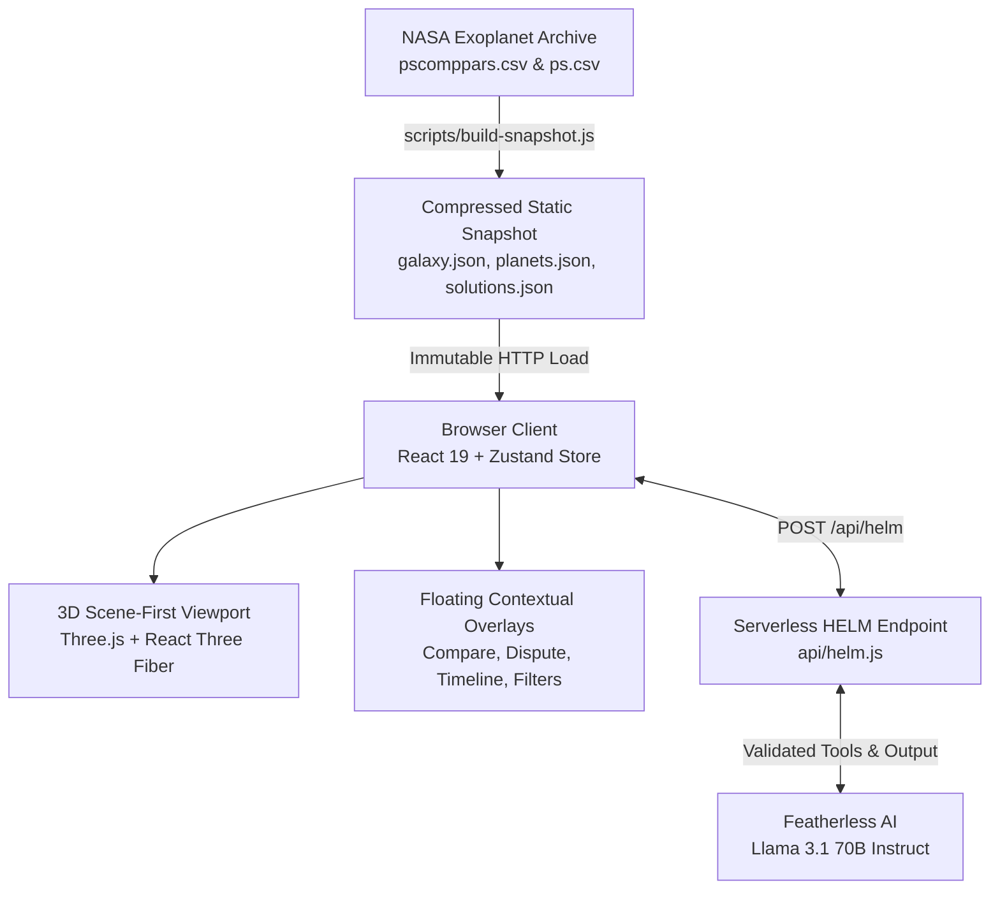

# Team Tetris Exoplanet Explorer

An interactive, scientifically honest 3D exoplanet visualization and exploratory analysis platform powered by verified astronomical data from the **NASA Exoplanet Archive** (`pscomppars` & `ps` tables) and an AI copilot (**HELM**).

Built with **React 19**, **Three.js / React Three Fiber**, **Zustand**, and **D3.js**.

---

## 🌌 Core Principles & Scientific Honesty

- **Zero Invented Science:** Missing archive measurements remain strictly `null` in data and display as a grey `"unknown"` tag in the UI. Missing values are never zero-filled, estimated, or round-filled.
- **Strict Science Framing:** Never claims a planet is "habitable", "uninhabitable", or "supports life". Uses objective astronomical terms: *"habitable zone position"*, *"potential habitability indicators"*, and mounts mandatory observational detection bias caveats.
- **Immutable Provenance Receipts:** Every numeric measurement in the explorer is an identifiable `Field` carrying an immutable receipt tag (`<planetId>.<fieldName>`), tracking whether it came directly from archive literature, a published formula, or an explorer heuristic, with citation links and uncertainty bounds.
- **Zero Runtime Catalog Calls:** The client and serverless functions never make live calls to external TAP catalogs at runtime. All data is served from verified, immutable static snapshots.
- **Separation vs. Orbit Semi-Major Axis Honesty (`DEC-012`):** Direct imaging and microlensing discoveries reporting projected separation (or missing co-referenced period and eccentricity) are clearly tagged as unestablished 3D orbits rather than conflated with Keplerian semi-major axis.

---

## 🔭 Key Features

### 1. Scene-First 3D Exoplanet & System Explorer
- **Fullscreen 3D Viewport (`SceneRoot`):** Dominates the entire window with seamless camera transitions between **Galaxy**, **System**, and **Planet** levels.
- **Galaxy Point Cloud (`GalaxyPoints`):** Renders **4,819 positioned host stars** in heliocentric Cartesian coordinates derived from celestial coordinates (`ra`, `dec`) and sky distance (`sy_dist`). Color-coded by observational detection method to expose survey bias.
- **System View (`SystemView`):** Interactive host star with accurate Harvard spectral sequence coloration (`StarMesh`), circular and eccentric Keplerian orbits ($0.05 \le e < 0.95$) with major-axis focus offsets (`OrbitLine`), and Kopparapu et al. (2013) habitable zone bands.
- **Planet Inspection (`PlanetView`):** Procedural FORGE-lite visual classification meshes (`PlanetMesh`) spanning terrestrial rocky worlds, volatile-rich sub-Neptunes, Jovian gas giants (with optional rings), incandescent glowing hot/lava worlds, and specular icy planets, complete with atmospheric Fresnel glow shells (`AtmosphereGlow`). All visuals are honestly labelled *"Artist's impression • Not to scale"*.

### 2. HELM — Astronomer AI Copilot
- **Live Featherless AI Integration (`/api/helm`):** Server-side LLM copilot utilizing Meta Llama 3.1 70B via Featherless AI. API credentials never reach the browser or build output.
- **5 Typed Schema-Validated Tools:**
  - `search_planets`: Multi-criteria filter searches over the snapshot catalog.
  - `focus_camera`: Controlled camera transitions between galaxy, system, and planet views.
  - `highlight_planets`: Highlights matching target planets in the 3D scene.
  - `open_timeline`: Sets the discovery year threshold on the timeline scrubber.
  - `compare_planets`: Opens the VERSUS comparison drawer with selected planet targets.
- **Strict Output Validator:** Sanitizes AI output, verifies provenance receipts against snapshot data, strips ungrounded claims, and blocks forbidden habitability verdicts.
- **Deterministic Canned Queries (#1 to #5):** Instant offline local execution fallback covering top habitable zone candidates, multi-solution disputes, TRAPPIST-1 e vs Earth comparison, discovery timeline milestones, and nearest exoplanet exploration.

### 3. DISPUTE — Multi-Solution Literature Strip Plot
- **Interactive D3 Strip Plot (`DisputeStripPlot`):** Visualizes individual published planetary solutions from NASA's `ps` table across radius, mass, orbital period, semi-major axis, and temperature.
- **Honest Uncertainty & Interval Overlap:** Renders measurement values with reported error bars, upper/lower limit flags, and publication citations, calculating whether published solutions statistically agree or conflict.
- **Cross-Catalog Agreement:** Non-authoritative reconciliation against exoplanet.eu data using Exo-MerCat identifiers.

### 4. VERSUS — Side-by-Side Planet Comparison
- **Multi-Body Comparative Matrix (`CompareDrawer` / `ComparePanel`):** Compare 2 to 3 exoplanets side-by-side alongside Solar System baselines (Earth and Jupiter reference records from the NASA Planetary Fact Sheet).
- **Selection Tray (`CompareTray`):** Live selection counter (`0/3` to `3/3`), one-click body removal, and quick reference presets (`TRAPPIST-1 e vs Earth`, `Proxima Cen b vs Earth`).
- **Comprehensive Properties:** Side-by-side evaluation of radius, mass, density, period, orbit distance, temperature, insolation, stellar Teff, host distance, and HAB-LAB checklist indicators.

### 5. Discovery Timeline Scrubber
- **Temporal Exploration (`TimelineBar`):** Scrub discoveries from 1992 through 2026. Scrubbing backwards dynamically removes systems discovered after the selected year from the 3D galaxy scene.
- **Observational Detection Bias Visualization:** Host stars color-coded by detection technique (Transit, Radial Velocity, Microlensing, Direct Imaging) to clearly illustrate historical survey cones and selection biases.

### 6. Resilient UI & Panel Error Boundaries
- Floating contextual glass overlays (Filters, Search, Stats, Timeline, Compare, HELM, Planet Card) that stay accessible without obstructing the 3D canvas.
- Component-level error boundaries (`PanelErrorBoundary`) ensure isolated overlay edge cases never blank the page or crash the WebGL scene.

---

## 🛠️ Architecture & Tech Stack



- **Frontend:** React 19, Vite, Three.js, `@react-three/fiber`, `@react-three/drei`, Zustand, D3-Scale, Zod
- **Backend / HELM:** Node.js, Vercel Serverless Function (`/api/helm`), Featherless AI API
- **Testing:** Vitest (180 unit and integration tests across 16 suites)
- **Data Pipeline:** Custom Brotli/columnar snapshot encoder, PapaParse

---

## 🚀 Getting Started

### Prerequisites
- **Node.js**: v18.0.0 or higher
- **npm**: v9.0.0 or higher

### Installation

```bash
git clone https://github.com/gayathri-216/HFT26-TEAM-2.git
cd HFT26-TEAM-2
npm install
```

### Environment Configuration (Optional — for Live HELM AI)

Create a `.env.local` file in the root directory to enable live Featherless AI inference (if omitted, HELM operates seamlessly in local deterministic/canned mode):

```env
FEATHERLESS_API_KEY=your_featherless_api_key_here
```

> **Security Note:** `FEATHERLESS_API_KEY` is strictly server-side and never exposed to the client bundle.

### Development Server

Start the frontend development server:

```bash
npm run dev
```

Open [http://localhost:5173](http://localhost:5173) in your browser.

To run the local backend server for `/api/helm`:

```bash
npm run dev:api
```

---

## 🧪 Testing & Verification

Run the full automated test suite (180 tests across 16 test files):

```bash
npm test
```

### Production Build

Verify the production build:

```bash
npm run build
```

---

## 📜 Scientific Citations & Attributions

- **Data Sources:** [NASA Exoplanet Archive](https://exoplanetarchive.ipac.caltech.edu/) (`pscomppars` and `ps` tables), California Institute of Technology.
- **Solar System Reference:** [NASA Planetary Fact Sheet](https://nssdc.gsfc.nasa.gov/planetary/factsheet/), NASA Goddard Space Flight Center.
- **Habitable Zone Models:** Kopparapu, R. K., et al. (2013). *"Habitable Zones around Main-Sequence Stars: New Estimates"*, ApJ, 765, 131; and Erratum (2014) ApJ, 787, L29.
- **Cross-Catalog Bridge:** Exo-MerCat (Breslau et al.) & The Extrasolar Planets Encyclopaedia ([exoplanet.eu](http://exoplanet.eu/)).

---

## 👥 Team Tetris
Developed as part of the NASA Space Apps / Hackathon Exoplanet Explorer Initiative.
